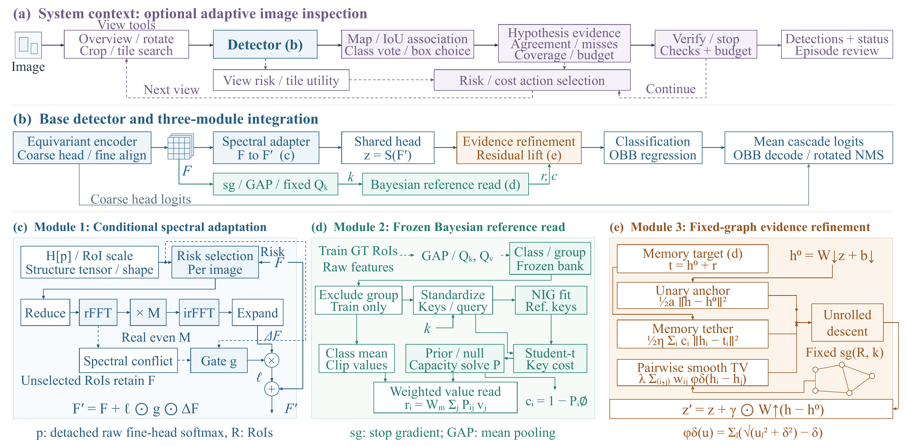
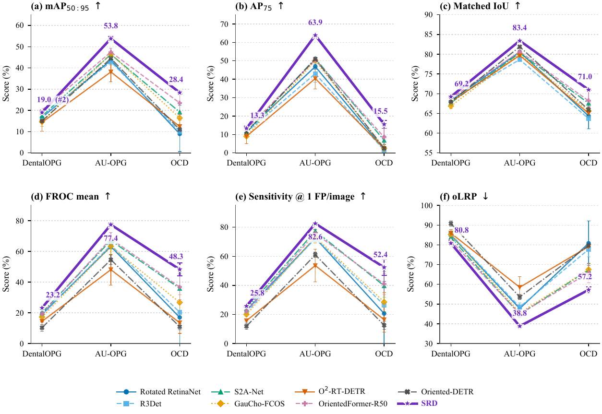

# Spectral Reference Detector（SRD）

论文 **SRD: A Reference-Grounded Perception Tool for Agentic Medical Image Inspection** 的官方代码仓库。

[English](README.md) | [简体中文](README_zh-CN.md)

SRD 面向医学图像旋转目标检测，在成熟的两阶段旋转检测器上加入三个证据模块：条件频谱适配、冻结贝叶斯参考读取和固定图证据细化。

> 当前首个开源版本提供模型实现、Notebook、测试和配置模板，不包含医学数据集或训练权重。

## 方法概览

- **条件频谱适配**：仅对被选中的对齐 RoI 施加方向感知的傅里叶残差。
- **冻结贝叶斯参考读取**：从仅由训练集构建的参考库中读取类别条件 Student-t 证据，并通过 null 选项和容量约束拒绝不可靠匹配。
- **固定图证据细化**：通过强凸 smooth-TV 目标协调局部、参考和邻域证据，再进入分类与旋转框回归。

模型还输出检测置信度、非空参考支持度和证据细化幅度，可供后续检查策略使用。当前实验评估的是单视图检测器，不包括策略级视图选择、验证或停止决策。

## 架构



## 主结果概览



该图展示 DentalOPG、AU-OPG 和 OCD 上的 clean-test 指标概况。精确复现仍需要原始数据集、冻结划分、验证集选择的 checkpoint 和下述固定环境。

## 环境

已验证环境：Windows x64、Python 3.11、PyTorch 2.1.1、CUDA 11.8、MMCV-full 1.7.2、MMDetection 2.28.2、MMRotate 0.3.4 和 e2cnn 0.2.3。

```powershell
.\scripts\setup_environment.ps1 -Python 'C:\path\to\python.exe'
```

完整训练和推理需要 CUDA 版本的 `RiRoIAlignRotated`。CPU 仅适用于部分数据与数学测试。

## 快速使用

```bash
git clone https://github.com/bill1034/SRD.git
cd SRD
```

1. 复制并修改 `configs/manifest.example.json`，填写自己的训练、验证和测试记录。
2. 在 `configs/paper_config.py` 或 Notebook 的配置单元中设置 `manifest_path` 和 `output_dir`。
3. 启动 `jupyter lab notebooks\SRD.ipynb`。
4. 使用验证集 mAP 选择 checkpoint；冻结 checkpoint 后再进行一次测试集评估。

旋转框格式为 `[中心x, 中心y, 宽, 高, 角度]`，坐标使用原图像素，角度为顺时针弧度并采用 `le90` 约定。数据划分必须使用互不重叠的病例或采集组。

论文配置启用 Spectral、Bayesian Memory 和 Fixed-graph Refinement 三个模块。代码中保留的可选 Quality Head 仅用于历史 checkpoint 兼容，论文配置默认关闭。

## 测试

```powershell
.\scripts\run_tests.ps1 -Python '.\.venv-srd\Scripts\python.exe'
```

当前版本包含 69 项测试，覆盖数据审计、旋转评价、三个证据模块、checkpoint 契约、分阶段训练和 Notebook 结构。

## 数据与权重

仓库不包含数据集、患者级元数据、预测结果或训练权重。请从原始发布方获取数据并遵守其许可证、访问条件和隐私要求。训练集参考库保存在 SRD checkpoint 中，验证和测试样本不得写入该参考库。

## 引用

论文正式发表后将补充完整引用信息。目前可使用仓库中的 `CITATION.cff` 软件元数据。

## 许可证与医学声明

SRD 采用 Apache License 2.0，详见 [LICENSE](LICENSE) 与 [NOTICE](NOTICE)。本仓库仅限研究用途，模型输出不能替代专业诊断、临床判断或患者照护。
